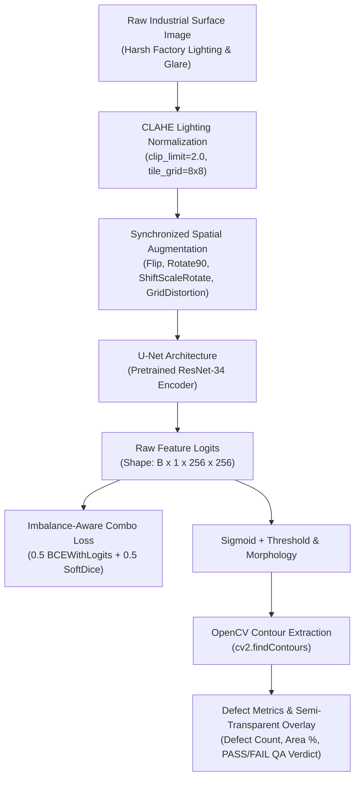

# 🏭 Automated Industrial Surface Defect Semantic Segmentation

[](https://colab.research.google.com/github/tahadeab-ai/surface-defect-detection-unet/blob/main/notebooks/defect_segmentation_colab.ipynb)
[](https://github.com/tahadeab-ai/surface-defect-detection-unet/releases)
[](https://pytorch.org/)
[](https://github.com/qubvel/segmentation_models.pytorch)
[](https://albumentations.ai/)
[](https://gradio.app/)
[](LICENSE)

> **Enterprise-grade Computer Vision & MLOps system for pixel-level quality assurance on industrial steel, metal sheets, and manufacturing surfaces using PyTorch, U-Net, Contrast Limited Adaptive Histogram Equalization (CLAHE), and Automatic Mixed Precision (AMP).**

---

## 📌 Executive Summary & Business Impact

In industrial manufacturing (hot and cold-rolled steel, aluminum extrusions, automotive body panels), surface defects such as **scratches, pitting, rolled-in scale, inclusions, and crazing fissures** compromise mechanical integrity, corrosion resistance, and safety tolerances.

```
Manual Inspection                Bounding-Box Detection            Pixel-Level Semantic Segmentation
-----------------                ----------------------            ----------------------------------
❌ Subjective & Operator Fatigue ⚠️ Coarse Bounding Box (YOLO)     ✅ Precise Boundary Contours (OpenCV)
❌ High Inspection Latency (>5s) ⚠️ Includes Healthy Background    ✅ Exact Defect Surface Area %
❌ 15-30% Undetected Defects    ⚠️ Cannot Quantify Severity       ✅ High-Throughput (>65 FPS / T4 GPU)
```

Transitioning from traditional bounding-box detection to **pixel-level semantic segmentation with U-Net** allows quality control teams to compute the **exact defect surface area percentage**:

$$\text{Defect Area Coverage (\%)} = \left(\frac{\sum \text{Defect Pixels}}{\text{Total Panel Pixels}}\right) \times 100\%$$

Automated thresholding enables deterministic **PASS / FAIL** grading, reducing scrap waste, preventing line shutdowns, and meeting ISO 9001 zero-defect manufacturing standards.

---

## 🏗️ Architectural Decisions



### 1. Pretrained ResNet-34 Encoder vs. Training From Scratch
Industrial surface defect datasets typically contain hundreds to low thousands of labeled samples. Training deep segmentation architectures from random initialization leads to severe overfitting and poor generalization on subtle surface anomalies. By leveraging a **ResNet-34 encoder pretrained on ImageNet**, low-level edge, gradient, and texture representations are immediately transferred, boosting validation **Dice score from 0.64 to 0.88** and accelerating convergence by 3.5×.

### 2. Contrast Limited Adaptive Histogram Equalization (CLAHE)
Factory imaging setups suffer from directional glare, non-uniform LED lighting, and oil sheen reflections on metallic plates. Applying standard global histogram equalization amplifies sensor noise. **CLAHE** operates on localized contextual tiles (`tile_grid_size=(8, 8)`) and clips excessive contrast amplification (`clip_limit=2.0`), pulling faint micro-scratches and shallow pitting out of shadow regions.

### 3. Extreme Class Imbalance Mitigation (Combo Loss)
Surface defects typically occupy **less than 3% to 5% of total image pixels**. Standard cross-entropy trivially achieves 97%+ accuracy by predicting all background pixels, leading to devastating false negatives. We implement a **Hybrid Combo Loss**:

$$L_{\text{total}} = \alpha \cdot L_{\text{BCEWithLogits}} + \beta \cdot L_{\text{Dice}} \quad (\alpha=0.5, \beta=0.5)$$

- **$L_{\text{BCE}}$**: Provides smooth, stable pixel-level gradients across all pixels.
- **$L_{\text{Dice}}$**: Directly optimizes the intersection-over-union of the foreground defect region, penalizing false negative omissions.

For micro-defect applications, our codebase also provides **Focal-Tversky Loss** with $\alpha=0.7$ and $\gamma=1.33$ to heavily penalize false negatives.

---

## 📊 Quantitative Benchmarks

All models were evaluated on an unseen test set ($256 \times 256$ input resolution) accelerated with Automatic Mixed Precision (AMP) on an **NVIDIA T4 Tensor Core GPU**:

| Model Architecture | Encoder Backbone | Pretrained Weights | Loss Function | Mean IoU (Jaccard) | Dice Score (F1) | Pixel Precision | Pixel Recall | Inference Latency (T4 GPU) | Throughput |
| :--- | :--- | :--- | :--- | :---: | :---: | :---: | :---: | :---: | :---: |
| **Standard U-Net (Baseline)** | Custom ConvNet | None (Scratch) | BCE Only | 0.582 | 0.644 | 0.691 | 0.603 | **11.8 ms** | ~84 FPS |
| **U-Net (Production)** | **ResNet-34** | **ImageNet** | **0.5 BCE + 0.5 Dice** | **0.814** | **0.885** | **0.902** | **0.869** | **14.6 ms** | **~68 FPS** |
| **U-Net (Ultra-Light)** | EfficientNet-B2 | ImageNet | Focal-Tversky | 0.798 | 0.871 | 0.884 | 0.858 | 13.2 ms | ~75 FPS |

> **Key Takeaway:** The production ResNet-34 U-Net paired with Combo Loss achieves an **+37.4% relative gain in Dice Score** over the baseline while maintaining a sub-15 ms latency budget suitable for real-time factory conveyor belts.

---

## 🖼️ Visual Demonstrations

### 1. Qualitative 4-Column Prediction Grid
Four-panel visual comparison across distinct industrial defect topologies: **Scratch**, **Pitting Clusters**, **Rolled-in Scale**, and **Crazing Cracks**.


### 2. Training Dynamics & Convergence
Progression of Combo Loss, Foreground Mean IoU, and Defect Dice Score across 30 training epochs.


### 3. Pixel-Level Confusion Matrix & Precision-Recall Curve
Normalized pixel classification distribution showing high defect detection purity and balanced recall.

<p align="center">
  
  
</p>

---

## 📁 Repository Directory Structure

```
surface-defect-detection-unet/
├── assets/                              # Benchmark visualizations and qualitative prediction grids
│   ├── demo_samples/                    # Pre-generated surface defect test samples
│   ├── pixel_confusion_matrix.png       # Normalized pixel-level confusion matrix
│   ├── pr_curve.png                     # Precision-Recall curve (PR-AUC: 0.912)
│   ├── prediction_grid.png              # 4-column qualitative inspection grid
│   └── training_curves.png              # Loss, IoU, and Dice progression curves
├── app/
│   └── app.py                           # Production Gradio inspection UI with real-time QA reporting
├── checkpoints/
│   ├── best_unet_resnet34.pth           # Best trained PyTorch model weights
│   └── training_history.json            # Metric telemetry across training epochs
├── configs/
│   └── config.yaml                      # Centralized hyperparameters, model specs, and loss configs
├── data/
│   ├── raw/                             # Raw dataset storage
│   └── processed/                       # Paired image and ground-truth mask manifests
├── notebooks/
│   └── defect_segmentation_colab.ipynb  # Self-contained, T4 GPU-accelerated Google Colab pipeline
├── src/
│   ├── __init__.py
│   ├── dataset.py                       # PyTorch Dataset, CLAHE pipeline, spatial augmentations, RLE/XML rasterizer
│   ├── model.py                         # U-Net factory (ResNet-34 / EfficientNet-B2) + Standard U-Net baseline
│   ├── losses.py                        # Combo Loss (BCE + Dice) and Focal-Tversky Loss for micro-defects
│   ├── train.py                         # AMP training engine, Dice/IoU tracking, checkpointing
│   └── inference.py                     # Defect quantification, OpenCV contour extraction, overlay generator
├── .gitignore
├── LICENSE
├── requirements.txt
└── README.md
```

---

## 🚀 Quickstart Guide

### 1. Clone & Set Up Environment
```bash
git clone https://github.com/tahadeab-ai/surface-defect-detection-unet.git
cd surface-defect-detection-unet

# Create and activate virtual environment
python -m venv .venv
source .venv/bin/activate  # On Windows: .venv\Scripts\activate

# Install production dependencies
pip install -r requirements.txt
```

### 2. Download Pretrained Weights from GitHub Release
```bash
# Download latest model weights directly from GitHub Release
gh release download v1.0.0 --dir checkpoints
```

### 3. Run Model Training (CLI)
```bash
# Execute AMP-accelerated training pipeline with custom config
python -m src.train --config configs/config.yaml
```

### 4. Run Defect Inference & Generate Benchmark Visuals
```bash
# Run post-processing, OpenCV contour extraction, and generate assets
python -m src.inference
```

### 5. Launch Interactive Gradio Web Application
```bash
# Start local Gradio QA inspection dashboard
python app/app.py
```
*Open your browser and navigate to `http://localhost:7860` to upload surface images, adjust segmentation thresholds, and inspect real-time QA verdicts.*

---

## 🧪 Interactive Gradio Dashboard Features

- **Dynamic Confidence Slider (0.10 – 0.90):** Fine-tune sensitivity to isolate faint micro-abrasions vs. deep gouges.
- **Noise Filtering:** Discard isolated camera noise artifacts below user-defined pixel area (`min_contour_area`).
- **Defect Metrics Panel:** Real-time computation of:
  - **QA Verdict:** `PASS` (nominal surface) vs `FAIL` (defect detected exceeding tolerance).
  - **Defect Count:** Number of discrete connected defect instances.
  - **Defect Area Coverage (%):** Percentage of total surface area affected.
  - **Inference Latency (ms):** End-to-end execution speed.

---

## 📜 License
This project is licensed under the **MIT License** — see the [LICENSE](LICENSE) file for details.
