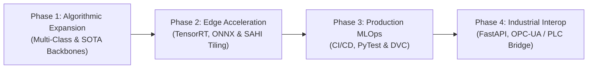

# 🚀 Strategic Development Roadmap: Industrial Surface Defect Segmentation

> **Target Goal:** Evolve the project from a research-grade PyTorch U-Net prototype into a battle-tested, high-throughput, edge-deployable Computer Vision system integrated into industrial steel and metal manufacturing lines.

---

## 🧭 Roadmap Overview & Phased Milestones



| Phase | Milestone Name | Primary Focus | Target Timeline | Key Deliverables |
| :--- | :--- | :--- | :---: | :--- |
| **Phase 1** | **Multi-Class & Advanced Architectures** | Defect Taxonomy & Modern Backbones | Weeks 1–3 | 6-class segmentation, SegFormer & EfficientNetV2 backbones |
| **Phase 2** | **Edge Optimization & High-Res Tiling** | Real-Time Line-Scan Camera Support | Weeks 4–6 | SAHI sliding-window inference, TensorRT FP16/INT8 compilation |
| **Phase 3** | **Production MLOps & Rigorous QA** | Reliability, Testing & Versioning | Weeks 7–8 | 100% PyTest coverage, GitHub Actions CI/CD, DVC data pipelines |
| **Phase 4** | **Industrial Systems & PLC Integration** | Factory Floor Hardware Integration | Weeks 9–11 | FastAPI microservice, OPC-UA/MQTT PLC bridge, automated PDF reports |

---

## 📌 Phase 1: Algorithmic Expansion & Defect Taxonomy

### 1.1 Transition from Binary to Multi-Class Defect Categorization
- **Current State:** Binary segmentation ($0 = \text{background}$, $1 = \text{defect}$).
- **Production Requirement:** Metallurgical engineers must distinguish between root causes (e.g., mechanical roller scratches vs. raw chemical inclusions vs. improper cooling crazing).
- **Implementation:**
  - Expand model head to $K=6$ classes (NEU-Seg taxonomy: *Crazing, Inclusion, Patches, Pitted Surface, Rolled-in Scale, Scratches*).
  - Adopt **Categorical Focal-Dice Loss** with class weighting to penalize rare defect categories.

### 1.2 Benchmark Modern Vision Transformer & Efficient Backbones
- Evaluate lightweight modern backbones alongside ResNet-34:
  - **SegFormer (MiT-B0 / MiT-B2):** Multi-scale transformer representations for long-range scratch continuity.
  - **ConvNeXt-Tiny & EfficientNet-B2:** Superior parameter-to-accuracy Pareto frontier.
  - **Fast-SCNN / MobileNetV3:** Ultra-lightweight backbones targeting $>120$ FPS on low-power devices.

---

## 📌 Phase 2: Edge Acceleration & High-Resolution Tiling

### 2.1 Patch-Based High-Resolution Slicing (SAHI Pipeline)
- **The Challenge:** Factory line-scan cameras capture steel coils at $4096 \times 2048$ or $8192 \times 4096$ resolution. Downsampling these to $256 \times 256$ destroys hairline micro-fissures and shallow pitting.
- **The Solution:**
  - Implement overlapping tile slicing (e.g., $512 \times 512$ windows with $20\%$ overlap stride).
  - Apply Gaussian apodization / morphological blending at patch seams to eliminate boundary artifacts.
  - Reconstruct the full-resolution defect coverage map seamlessly.

### 2.2 TensorRT & ONNX Runtime Quantization
- **Optimization Target:** Sub-5 ms inference on NVIDIA hardware.
- **Pipeline:**
  1. Export PyTorch graph to ONNX with dynamic batch dimensions.
  2. Profile with `trtexec` on target GPU.
  3. Calibrate INT8 quantization using representative factory surface calibration images.
  4. Benchmark speedup: Expect $2.5\times$ to $4\times$ latency reduction vs. FP32 PyTorch.

### 2.3 Edge Target Validation (NVIDIA Jetson)
- Containerize the engine using NVIDIA JetPack on **Jetson Orin Nano / AGX Orin**.
- Verify thermal stability and sustained FPS over continuous 48-hour burn-in testing.

---

## 📌 Phase 3: Production MLOps, CI/CD & Automated Testing

### 3.1 Comprehensive Test Suite (`pytest`)
Implement robust automated unit and integration tests:
- **Loss Invariants:** Assert zero NaN gradients on edge cases (all-clean panels, 100% defect saturated panels).
- **Geometric Invariance:** Assert that rotation and horizontal flips yield equivalent segmented defect areas.
- **Rasterization Accuracy:** Unit test RLE decoder and VOC XML bounding-box rasterizer against ground-truth bitmaps.
- **Inference Latency SLA:** Fail tests if model latency regresses beyond $+15\%$ of baseline budget.

### 3.2 GitHub Actions CI/CD Pipeline
- **Linting & Code Quality:** Automated `ruff`, `black`, and `mypy` strict type checking on every pull request.
- **Model Regression Checks:** Run automated evaluation against a golden benchmark test slice on PR merge.
- **Automated Artifact Packaging:** Tagged releases automatically compile ONNX models and upload release archives.

### 3.3 Data Version Control (DVC) & Experiment Tracking
- Decouple raw gigabyte datasets from git history using **DVC** backed by Amazon S3 or Google Cloud Storage.
- Track hyperparameter sweeps, loss curves, and validation splits via **Weights & Biases (W&B)** or **MLflow**.

---

## 📌 Phase 4: Industrial Systems & PLC Factory Integration

### 4.1 Production REST & WebSocket Microservice (FastAPI)
- Replace single-user Gradio with asynchronous **FastAPI** service:
  - `/api/v1/inspect`: Low-latency image buffer upload with JSON diagnostic response.
  - `/api/v1/stream`: WebSocket channel for streaming live camera frames.
  - Prometheus `/metrics` endpoint tracking requests/sec, P95/P99 latency, and defect detection rate.

### 4.2 Factory PLC Hardware Bridge (OPC-UA / MQTT / Modbus TCP)
- **Direct Automation Interop:**
  - Establish an **OPC-UA server / client** bridge.
  - When inspection verdict is `FAIL` (defect coverage $> \text{threshold}$), emit a discrete digital output signal to the factory **Programmable Logic Controller (PLC)**.
  - Triggers physical pneumatic sorters or optical markers on the conveyor belt within $<25\text{ ms}$ of camera exposure.

### 4.3 Executive Quality Analytics & Batch PDF Reporting
- Real-time factory dashboard:
  - Defect density heatmaps across steel coil reels.
  - Shift-by-shift scrap rate trends (Day Shift vs. Night Shift variance).
  - Automated generation of **ISO 9001 compliance inspection certificates (PDF)** for each steel batch with embedded defect crops and timestamps.

---

## 🛠️ Recommended Technology Stack

```
Layer                  Technologies
---------------------  -------------------------------------------------------------
Deep Learning & CV     PyTorch, Segmentation Models PyTorch (SMP), Albumentations, OpenCV
Edge Acceleration      ONNX Runtime, NVIDIA TensorRT, DeepStream SDK
Serving & API          FastAPI, Uvicorn, Celery, Redis
Industrial Protocols   python-opcua (OPC-UA), paho-mqtt, pymodbus
MLOps & Versioning     DVC, Weights & Biases / MLflow, GitHub Actions
Testing & Quality      PyTest, Hypothesis (Property Testing), Ruff, Mypy
Containerization       Docker, NVIDIA Container Toolkit, Docker Compose
Databases & Telemetry  PostgreSQL / TimescaleDB, Prometheus, Grafana
```
